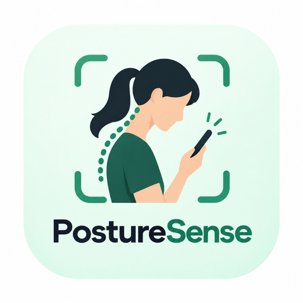
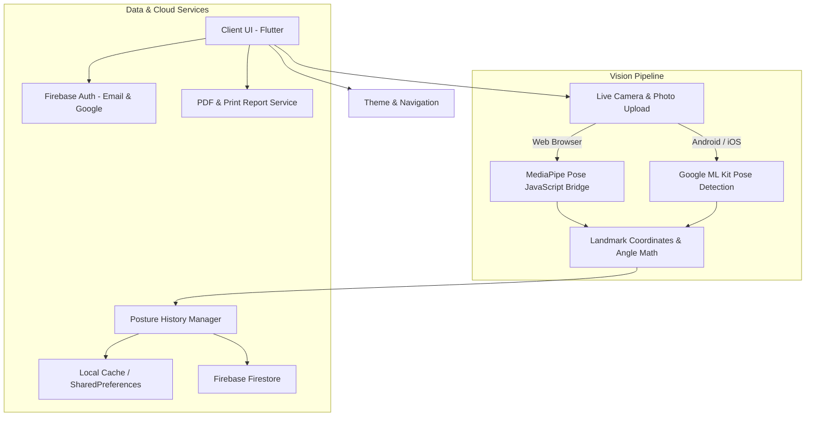

# 🩺 PostureSense — AI Text Neck & Posture Analyzer

<div align="center">



<h3>Intelligent Real-Time Computer Vision & Biomechanical Posture Correction</h3>

[](https://flutter.dev)
[](https://dart.dev)
[](https://firebase.google.com)
[](https://mediapipe.dev)
[](https://developers.google.com/ml-kit)
[](#supported-platforms)
[](LICENSE)

<p align="center">
  <b>Detect Forward Head Posture ("Text Neck") in Real Time • Biomechanical Metrics • Personalized Physiotherapy Exercises • Clinical PDF Reports</b>
</p>

</div>

---

## 📖 Overview

**PostureSense** is an AI-powered computer vision application engineered to combat **Text Neck Syndrome** — the forward flexion posture caused by excessive smartphone, tablet, and computer screen usage. 

By tracking key anatomical landmarks (Tragus/Ear, Acromion/Shoulder, C7 Cervical Spine, Hip) via real-time camera streams or uploaded profile photos, PostureSense computes clinical ergonomic angles such as the **Craniovertebral Angle (CVA)** and **Cervical Flexion**. It provides instant visual and audio biofeedback, logs historical posture progress, prescribes targeted corrective physiotherapy exercises, and exports comprehensive clinical PDF assessment reports.

---

## ✨ Key Features

### 🎥 1. Real-Time Camera Posture Analysis
- **Live Stream Tracking**: Evaluates real-time webcam and smartphone camera video at 30+ FPS.
- **Biomechanical Landmark Overlay**: Detects and overlays ear, shoulder, and spinal alignment lines in real-time.
- **Immediate Biofeedback**: Color-coded feedback (🟢 Good, 🟡 Fair, 🔴 Poor) with audible posture alerts to prevent prolonged cervical fatigue.
- **Cross-Platform Vision Engine**:
  - **Mobile (Android/iOS)**: Accelerated on-device pose estimation via **Google ML Kit Pose Detection**.
  - **Web (Chrome/Edge)**: Hardware-accelerated browser vision pipeline utilizing **Google MediaPipe Pose** with Shadow DOM stream interception.

### 📸 2. Photo Analysis Mode
- Capture a single side-profile photo or upload from the device gallery.
- Automated anatomical landmark detection and angle triangulation.
- Detailed angular breakdown comparing detected values against clinical norms.

### 📊 3. Interactive Analytics & Ergonomic Dashboard
- **Daily & Weekly Posture Scores**: Dynamic posture stability score out of 100%.
- **Trend Charts**: Interactive time-series visual analytics powered by `fl_chart`.
- **Session History**: Detailed audit trail of past scans with timestamps, duration, and angle deviations.
- **Local & Cloud Sync**: Instant local caching using `shared_preferences` with seamless synchronization to Firebase Cloud Firestore.

### 🧘 4. Corrective Exercise Program
- Curated physical therapy exercises specifically targeted at text neck and upper crossed syndrome:
  - **Chin Tucks** (Deep Cervical Flexor activation)
  - **Upper Trapezius & Levator Scapulae Stretch** (Relieving tension headaches & neck stiffness)
  - **Doorway Chest Stretch** (Pectoralis minor release for rounded shoulders)
  - **Scapular Wall Slides & Retractions** (Strengthening rhomboids & middle trapezius)
- Integrated timers, rep counters, step-by-step instructions, and target muscle breakdowns.

### 📄 5. Clinical PDF Report Generation
- Generate professional, exportable medical and ergonomic evaluation reports.
- Includes patient metadata, mean CVA angles, cervical risk classification, trend graphs, and physician exercise prescriptions.
- Native printing and file export powered by `pdf` and `printing`.

### 🎨 6. Premium Ergonomic UI
- **Light & Dark Mode**: Dynamic theme switcher with soothing dark ergonomic palettes.
- **Floating Pill Navigation**: Smooth tab transitions with zero-lag state preservation (`IndexedStack`).
- Modern typography powered by Google Fonts (`Inter`).

---

## 📐 Biomechanical Principles & Clinical Angles

PostureSense calculates posture metrics grounded in ergonomic literature:

| Metric | Measurement Landmarks | Normal / Good | Fair (Mild Strain) | Poor (Severe Text Neck) |
| :--- | :--- | :--- | :--- | :--- |
| **CVA** *(Craniovertebral Angle)* | Line from Tragus of the ear to C7 vertebra vs. Horizontal | **> 50°** | **45° – 49°** | **< 45°** |
| **Forward Head Displacement** | Horizontal offset between ear and shoulder | **< 2.5 cm** | **2.5 – 5.0 cm** | **> 5.0 cm** |
| **Shoulder Tilt / Alignment** | Left Acromion to Right Acromion delta | **< 3°** | **3° – 6°** | **> 6°** |

> *A lower Craniovertebral Angle indicates significant anterior translation of the head, exponentially increasing compressive spinal load (up to 60 lbs of pressure at 60° flexion).*

---

## 🛠️ Tech Stack & Architecture



- **Framework**: [Flutter](https://flutter.dev) (v3.47+) & [Dart](https://dart.dev) (v3.13+)
- **Computer Vision**:
  - Web: Google MediaPipe Pose (`@mediapipe/pose`) via JavaScript interop bridge
  - Mobile: `google_mlkit_pose_detection`
- **Backend & Cloud**:
  - Firebase Authentication (`firebase_auth`, `google_sign_in`)
  - Cloud Firestore (`cloud_firestore`)
  - Firebase Storage (`firebase_storage`)
- **State & Storage**:
  - `shared_preferences` for offline persistence & snappy UI responsiveness
  - `flutter_dotenv` for environment configuration
- **Visuals & Charts**:
  - `fl_chart` for ergonomic analytics
  - `google_fonts` (Inter)

---

## 📂 Project Structure

```text
TEXT_NECK/
├── .env.example                     # Environment template
├── .gitignore                       # Git ignore configuration
├── README.md                        # Documentation & setup guide
└── flutter_app/                     # Main Flutter application
    ├── assets/
    │   └── images/                  # App icons and posture guide illustrations
    ├── lib/
    │   ├── camera/
    │   │   └── live_camera_stream.dart    # Live camera capture & stream processing
    │   ├── posture/
    │   │   └── posture_result_overlay.dart# Canvas painter for skeletal landmarks & metrics
    │   ├── screens/
    │   │   ├── home_screen.dart           # Root scaffold with floating navigation
    │   │   ├── dashboard_view.dart        # Real-time stats, streaks & analytics
    │   │   ├── posture_scan_screen.dart   # Live posture scanning screen
    │   │   ├── photo_analysis_screen.dart # Image upload & photo posture analysis
    │   │   ├── analysis_results_screen.dart# Detailed scan breakdown & metrics
    │   │   ├── exercise_screen.dart       # Corrective physiotherapy exercises
    │   │   ├── profile_screen.dart        # User profile, cloud sync & preferences
    │   │   └── login_screen.dart          # Firebase authentication & sign-in
    │   ├── services/
    │   │   ├── auth_service.dart          # Firebase & Google Authentication
    │   │   ├── pdf_report_service.dart    # Exportable clinical PDF reports
    │   │   ├── posture_history_manager.dart# Local cache & Firestore persistence
    │   │   └── web_pose_bridge_web.dart   # Web MediaPipe JS interop bridge
    │   ├── theme/
    │   │   ├── app_colors.dart            # Harmonious color tokens (Light & Dark)
    │   │   └── theme_controller.dart      # Reactive theme manager
    │   ├── widgets/                       # Reusable UI cards, gauges & dialogs
    │   ├── firebase_options.dart          # FlutterFire configuration
    │   └── main.dart                      # Application entrypoint
    ├── web/
    │   └── index.html                     # Web entrypoint with MediaPipe scripts
    └── pubspec.yaml                       # Dependencies and asset declarations
```

---

## 🚀 Getting Started

### Prerequisites

- [Flutter SDK](https://docs.flutter.dev/get-started/install) (`>= 3.24.0` or later)
- [Dart SDK](https://dart.dev/get-dart) (`>= 3.5.0`)
- A modern web browser (Google Chrome or Microsoft Edge recommended) or an Android/iOS device/emulator.

### Installation

1. **Clone the Repository**:
   ```bash
   git clone https://github.com/JolinSaraiya/TEXT_NECK.git
   cd TEXT_NECK/flutter_app
   ```

2. **Configure Environment Variables**:
   Ensure `.env` exists in `flutter_app/.env` (or copy from the provided template):
   ```properties
   # Flutter Custom Variables
   API_URL=https://example.com/api
   DEBUG_MODE=true

   # Firebase Configuration
   FIREBASE_PROJECT_ID=text-neck-ai
   FIREBASE_MESSAGING_SENDER_ID=your_sender_id
   FIREBASE_STORAGE_BUCKET=your_bucket.firebasestorage.app
   FIREBASE_WEB_API_KEY=your_api_key
   FIREBASE_WEB_APP_ID=your_app_id
   FIREBASE_ANDROID_API_KEY=your_android_key
   FIREBASE_ANDROID_APP_ID=your_android_app_id
   ```

3. **Install Dependencies**:
   ```bash
   flutter pub get
   ```

---

## 💻 Running the Application

### Run on Chrome (Web)
```bash
flutter run -d chrome --web-port 8080
```
*The app will automatically launch in Google Chrome with full MediaPipe Pose support.*

### Run on Android
```bash
flutter run -d android
```

### Run on Windows Desktop
```bash
flutter run -d windows
```

---

## 🧪 Static Analysis & Code Quality

Verify the codebase health:
```bash
flutter analyze
```

---

## 🤝 Contributing

Contributions, feedback, and pull requests are warmly welcomed!
1. Fork the Project
2. Create your Feature Branch (`git checkout -b feature/AmazingFeature`)
3. Commit your Changes (`git commit -m 'feat: Add AmazingFeature'`)
4. Push to the Branch (`git push origin feature/AmazingFeature`)
5. Open a Pull Request

---

## 📄 License

Distributed under the MIT License. See `LICENSE` for more information.

---

<div align="center">
  <sub>Developed with ❤️ for healthier posture and spinal wellness.</sub>
</div>
